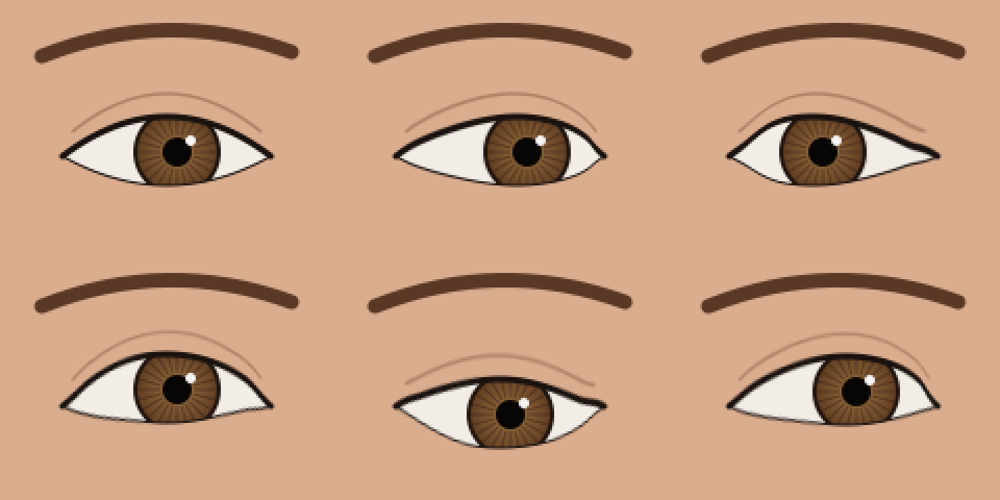

# Gaze Director

A macOS prototype that keeps your eyes on the camera while you read from the screen. While you read, it shows your eyes looking at the camera. Every few seconds it adds a short, natural-looking glance away. There is no machine-learning training involved: it uses Vision face landmarks, a classic gradient-based iris locator and a Metal warp of your own eye pixels.



## How it works

```
Camera (AVCaptureSession, BGRA)
  → Vision face landmarks: eye contours + rough pupil
  → Iris centre per eye: gradient-based locator (Timm & Barth) in an eye-aligned crop, One Euro smoothing
  → Gaze director: is the (low-passed) gaze reading, i.e. inside the zone and closer to the
    reading centre than to the camera point? Blinking? Head turned?
       reading → target = camera point + tiny fixation shifts + a glance away every 2–3.5 s
       else    → let the real eyes through
  → Metal warp: shift each iris by (target − calibrated reading offset), lids follow on vertical moves
  → Preview (later: virtual camera for Teams / Meet)
```

- **No new pixels.** The warp moves your own pixels. The iris slides and the sclera compresses on one side and stretches on the other. Eye corners stay pinned. On vertical moves the upper lid follows the iris more than the lower lid does.
- **Behaviour matters more than pixels.** Glance timing is randomised. Glances move as fast saccades (about 50 ms), not slow slides. You glance away more often while talking (2–3.5 s apart) than while listening (4–7 s apart). Blinks pass through. When you really look away or turn your head, the effect lets go.
- **Calibrated to you.** You look at the camera lens once to record each iris's "eye contact" position. Then you read normally for 8 seconds, and the app learns the reading zone and the typical reading offset from where your eyes actually go.
- **Steady, not twitchy.** On a real 1080p webcam, Vision gives only six contour points per eye and the per-frame iris estimate jitters by about ±2 px. That is as large as the whole reading offset. So the warp mainly corrects by the fixed calibrated offset. With Vision's pupil as the iris source, per-frame noise is low enough that *Follow reading motion* (default 0.5) also cancels half of the left-right reading sweep.
- **Vertical gaze from the eyelid.** Vision's pupil barely moves vertically, but the upper lid follows vertical gaze closely. When the eyes open wider while reading than while looking at the lens (the reading spot is higher), or narrower (lower), that change sets the vertical correction. Landmark estimates also tend to under-read the offset, so a *Strength* slider scales it. 1.4× matched a camera-look frame best in a recorded session.
- **The warp follows the iris, not the contour.** Vision's six-point contour cuts through the iris on real faces, and clipping the warp to it held real moves to about 40% of the plan. The iris now shifts as a whole, the band around it stretches, and the contour only pins the eye corners.
- **Iris source.** By default the iris position is Vision's pupil landmark. In recorded sessions it was steady (±0.3 px while staring at the lens) and gave the same reading offset across sessions. The gradient locator is still available as an option. It reacts to vertical gaze better, but on dark irises a screen reflection in the pupil can make it jump between two spots. In one session that made the calibrated offset 2.5× too large.

## Build and run

Requirements: macOS 14+, Xcode, [XcodeGen](https://github.com/yonaskolb/XcodeGen).

```bash
xcodegen generate
open GazeDirector.xcodeproj
```

Run the `GazeDirector` scheme. The run configuration is Release because the per-frame iris search is unoptimised in Debug builds. Signing uses the team in `project.yml`; change `DEVELOPMENT_TEAM` to yours.

## Using it

1. Put the text you will read **at the top centre of the screen, right under the camera**, in a **narrow column**. This one setting matters more than any algorithm tweak: it keeps the needed correction to a few degrees, where the warp is hard to spot.
2. Click **Calibrate** and look straight into the lens. After 2 seconds a chime plays: read your text normally until the second chime (8 seconds). Doing only the camera step clears the reading zone and turns correction off; the badge on the preview says so.
3. Read. The gaze map shows the reading zone (blue), your real gaze (●) and where the eyes are being shown (○). The debug overlay draws the eye contours, the tracked iris and the target.

To judge the result, use **Record 15 s clip** and read normally. Watching the live preview while reading moves your gaze out of the reading zone, which switches the correction off. The clip saves original | corrected side by side to `~/Movies/GazeDirector` and opens it. A green square marks corrected frames.

Settings: talk mode (*I'm talking* / *I'm listening* / *Detect with microphone*), glances on/off, and max correction (in fractions of eye width; above roughly 0.16 the warp becomes noticeable).

## Tools

- `GazeCore/` is a Swift package with all the testable logic: eye geometry, iris locator, One Euro filter, calibration, the director and the warp planner. Run its tests with `cd GazeCore && swift test`.
- `Tools/warp-preview.sh` renders a synthetic eye through the real shader and writes `Tools/out/warp-preview.png`.
- Calibration saves raw frames and measurements to `~/Library/Application Support/GazeDirector/Diagnostics` (sidebar toggle, local only).
  - `Tools/eye-probe.sh <frame.png>` draws the tracked contours and iris on a saved frame.
  - `Tools/out/warp-frame <camera-folder> <reading-folder> <frame.png> <out.png> [--strength 1.4] [--follow 0.5]` applies the full correction to a saved reading frame. It writes recorded | corrected | camera-look reference side by side.
  - `Tools/out/replay [--vision] <camera-folder> <reading-folder>` (built like the other tools, from `Tools/Replay`) replays a calibration through the director and warp planner. It reports how often redirection is on and how much the warp jitters.

## Limitations

- Vision's pupil barely moves vertically, so with the default iris source the correction is mostly horizontal. Keep the text roughly level with the camera, at the top of the screen.
- Glasses with reflections, strong side light and big head turns make tracking and the warp less reliable.
- The catchlight moves with the iris. At webcam resolution this is barely visible.
- It looks most convincing in a normal call tile. Full-screen high-resolution viewing shows more.

## Roadmap

- [ ] CoreMediaIO Camera Extension, so Teams, Meet, Zoom and FaceTime can pick "Gaze Director" as a camera.
- [ ] Zoomed eye view for tuning.
- [ ] Optional learned warp trained on your own calibration recordings.
